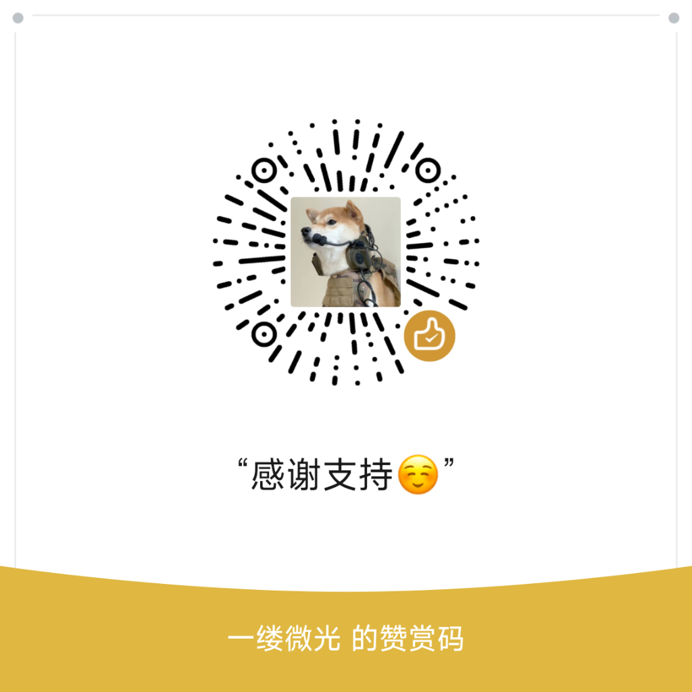

# ⚡ Tesla CarWith Box

<p align="center">
  
  
  
  
  
</p>

> **0 硬件成本 · 0 投屏盒子 · 0 电脑依赖**  
> 将小米手机（澎湃 HyperOS / MIUI）的 **CarWith 原生车联系统**无缝流式串流至 **特斯拉车机浏览器**，享受高帧率双向触控与澎湃OS 4.0 原生声音流转体验。
Q群:1127899055

---

## 🌟 核心特性

- 🚀 **0 硬件投入**：不需要购买任何第三方 CarLife/CarPlay 转接盒子或树莓派，一部已 Root 的小米手机搞定一切。
- ⚡ **后台静默直连**：自研后台无感守护与生命周期调度，手机切屏、息屏不中断，无需手动在前台点击打开百度 CarLife。
- 🌐 **公网域名欺骗与穿透**：通过智能 DNS 与 NAT 映射伪装为 `t.carwith.com`（`101.200.208.6`），彻底解决特斯拉车机浏览器拒绝访问私有局域网 IP（如 192.168.x.x）的问题。
- 🎵 **澎湃OS 4.0 声音流转自由切换**：
  - 深度注入系统播控中心（SystemUI），播控面板直观呈现 **【虚拟车机】**、**【车载蓝牙】**、**【本机】**。
  - 支持三向任意切换：可直通特斯拉原生车载蓝牙音响，也可使用特斯拉车机网页端 Web Audio 播放，彻底解决传统方案音频被劫持/手机静音的问题。
- 🔊 **Web Audio API 零底噪音频引擎**：车机网页端采用 44.1kHz 双声道 Web Audio 实时流式调度，未播放音乐时 **0 dB 绝对无噪**，音乐播放时 20~50ms 超低延迟。
- 👆 **自适应双向触控**：支持挂挡等比居中自适应、单点触控、精准滑动、双指缩放地图等。
- 📱 **独立双屏模式**：车机显示独立的 CarWith 车载桌面，手机端可自由使用微信、微信读书或其他应用，互不干扰。

---

## 📱 系统与运行环境要求

1. **手机端**：
   - 小米 / Redmi 手机（运行 Xiaomi HyperOS 1.0 / 2.0 / MIUI 14）。
   - 已获取 Root 权限（推荐 **KernelSU** / **APatch** / **Magisk**）。
   - 已安装并激活 **LSPosed**（Zygisk 模式）。
2. **车机端**：
   - 特斯拉全系车型（Model 3 / Y / S / X），拥有内置车机浏览器。

---

## 🚀 快速上手

### 1. 刷入模块
1. 前往本项目的 [Releases 页面](../../releases) 下载最新版的 `tesla_carwith_box.zip`。
2. 打开 Magisk / KernelSU / APatch 刷入模块，**重启手机**。
3. 重启后打开 **LSPosed**，在模块列表中找到 **CarWithVirtualizer**，确保勾选并激活（勾选系统界面 SystemUI、小米 CarWith、百度 CarLife 等作用域）。

### 2. 车机连接
1. 手机开启个人热点（支持 2.4GHz / 5GHz）。
2. 特斯拉车机 Wi-Fi 连接手机热点（建议勾选“保持留在驱动中/换挡时保持连接”）。
3. 手机控制中心点击【CarWith】发起连接，或车机浏览器直接打开：
   ```text
   http://t.carwith.com
   # 或者直接访问
   http://101.200.208.6:8080
   ```
4. 进入页面后即刻畅享小米 CarWith 车联！

---

## 🔊 音频模式说明

在澎湃OS控制中心右上角的“声音流转”面板中，你可以根据偏好自由选择：

| 选项 | 声音输出通道 | 特点 | 推荐场景 |
| :--- | :--- | :--- | :--- |
| **车载蓝牙** | 特斯拉物理车载音响 | 原生蓝牙音质，方向盘切歌滚轮完美控制 | ⭐ 最推荐（音质最佳） |
| **虚拟车机** | 特斯拉车机网页端声音 | 点击网页顶部“🔊 网页声音”出声，超低延迟无底噪 | 手机未配对车载蓝牙时 |
| **本机** | 手机扬声器 | 声音由手机喇叭独立播放，车机仅作显示屏 | 车内有其他人休息时 |

---

## 🛠️ 技术原理架构

```text
[ 小米手机 HyperOS ]
  ├── CarWith (com.miui.carlink) ──> 虚拟显示屏 (VirtualDisplay)
  │                                           │
  ├── LSPosed (CarWithVirtualizer) <──────────┼── 注入虚拟蓝牙与车机广播
  │     ├── SystemUI 音频流转注入 (虚拟车机设备)
  │     └── AudioTrack / 音频防劫持拦截
  │                                           │
  ├── CarLifeVehicle (静默后台) <──────────────┘
  │     └── 音频 PCM 实时转发 (UDP 8089)
  │
  └── tesla_java_bridge (Linux 守护进程)
        ├── 屏幕捕获与 WebSocket/MJPEG 串流 (8080)
        ├── 特斯拉车机触摸反向驱动 (Input Event)
        ├── Web Audio PCM 串流服务 (/api/audio.pcm)
        └── 智能 DNS 解析转发引擎 (5354 -> t.carwith.com)
              │
              ▼ Wi-Fi 热点链路
[ 特斯拉车机浏览器 Chromium ]
  └── 访问 http://t.carwith.com (HTML5 + Web Audio API)
```

---

## ❤️ 支持与赞赏

如果你觉得这个项目好用，为你省下了购买数百元投屏盒子的费用，欢迎自愿打赏作者一杯热咖啡 ☕，支持后续持续维护与更新！

<p align="center">
  
  <br>
  <sub>“感谢支持😊” —— 一缕微光 的赞赏码</sub>
</p>

- **作者**：一缕微光
- **交流反馈 QQ**：867836055
- **Bug 反馈**：欢迎在 GitHub Issues 提交问题并附带手机型号、系统版本与日志。

---

## 📄 免责声明

1. 本项目仅供技术研究与交流使用，作者不对任何因使用本软件造成的手机异常、行车事故或车辆质保影响承担连带责任。
2. 行车期间请遵守交通安全法规，切勿在驾驶过程中操作车机屏幕。
